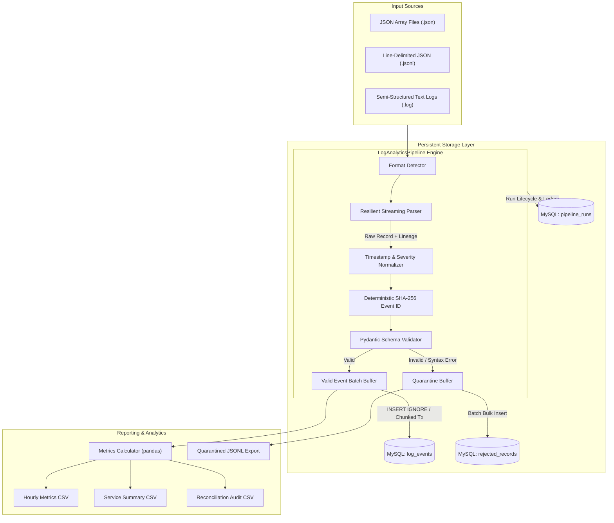

# LogAnalyticsPipeline

A production-grade, maintainable application log analytics pipeline built with Python, SQLAlchemy, PyMySQL, Pydantic, pandas, and MySQL.

The pipeline ingests multi-format application logs (JSON arrays, JSONL, and semi-structured text), normalizes timestamps to UTC and severities to canonical levels, validates records with strict schema checking, quarantines invalid inputs with explicit failure reasons, idempotently loads valid events into MySQL, and generates hourly/service-level error-rate and latency summaries.

---

## 1. System Architecture



---

## 2. Business Rules & Design Assumptions

### 2.1 Timestamp Normalization
- **Timezone-Aware Timestamps**: Automatically converted to timezone-aware UTC (`datetime.astimezone(timezone.utc)`).
- **Timezone-Naive Timestamps**: Assumed to be recorded in UTC (distributed application logging best practice) and localized to UTC.
- **Epoch Timestamps**: Numeric values in seconds or milliseconds are parsed directly.
- **Unparseable Timestamps**: Routed to quarantine with reason `INVALID_TIMESTAMP`.

### 2.2 Severity Canonicalization
Input severities are normalized to canonical levels:
- `DEBUG` (maps `TRACE`, `VERBOSE`, `DEBG`)
- `INFO` (maps `INFORMATION`, `NOTICE`)
- `WARNING` (maps `WARN`)
- `ERROR` (maps `ERR`)
- `CRITICAL` (maps `FATAL`, `CRIT`, `ALERT`, `EMERGENCY`)
- Unknown or missing severities are quarantined with `UNRECOGNIZED_SEVERITY: <val>`.

### 2.3 Deterministic Identity & Duplicate Policy
- If upstream supplies `event_id`, it is preserved.
- When omitted, a deterministic 32-character SHA-256 hash is computed from:
  `sha256("{source_file}:{source_line}:{service}:{endpoint}:{utc_timestamp}:{message}")`
- **Idempotency Guarantee**: Reprocessing the exact same source file produces the exact same event IDs, skipping duplicates via database `INSERT IGNORE` without error or duplicate rows.
- **Legitimate Distinct Events**: Separate log entries with identical messages (e.g. repeated health checks or cron jobs) generated at different lines or timestamps receive distinct hashes and are never discarded.

### 2.4 Error-Rate Calculation
- **Error Definition**: An event is classified as an error if `severity IN ('ERROR', 'CRITICAL')` OR `http_status >= 500`. Client errors (`4xx`) are not system errors unless marked with error severity.
- **Error Rate Denominator**: Total events for that group (`window_hour` and `service`).
- **Formula**: `error_rate_pct = (error_count / total_events) * 100.0`.

### 2.5 Latency Percentiles
- Excludes records where `latency_ms` is `null` from latency calculations.
- Computes arithmetic mean, p50 (median), p95, and p99.
- If a group has 0 latency values, latency metrics are output as `null` (avoiding artificial 0.0 ms values).

### 2.6 Accounting Reconciliation Formula
Every pipeline run strictly reconciles to the fundamental invariant:
$$\text{input\_count} = \text{valid\_count} + \text{rejected\_count} + \text{duplicate\_count}$$

---

## 3. Quick Start & Setup

### 3.1 Environment Prerequisites
- Python 3.10+ or Python 3.11
- MySQL 8.0+ or MariaDB 10.5+ (SQLite supported as an in-memory or fallback alternative)
- Git

### 3.2 Linux / macOS Setup Commands
```bash
# 1. Clone repository & navigate to directory
git clone <repo_url>
cd LogAnalyticsPipeline

# 2. Create and activate virtual environment
python3 -m venv .venv
source .venv/bin/activate

# 3. Upgrade pip & install dependencies
pip install --upgrade pip
pip install -r requirements.txt

# 4. Configure environment variables
cp .env.example .env
# Edit .env with your database credentials (never commit .env!)
```

### 3.3 Windows CMD Setup Commands
```cmd
:: 1. Navigate to directory
cd LogAnalyticsPipeline

:: 2. Create and activate virtual environment
python -m venv .venv
.venv\Scripts\activate.bat

:: 3. Upgrade pip & install dependencies
python -m pip install --upgrade pip
pip install -r requirements.txt

:: 4. Configure environment variables
copy .env.example .env
:: Edit .env with your database credentials
```

---

## 4. Running the Pipeline & Tools

### 4.1 Initialize Database Schema (DDL)
```bash
# Initialize MySQL tables using SQL DDL
mariadb -u <user> -p < sql/schema.sql
# Or MySQL:
mysql -u <user> -p < sql/schema.sql
```

### 4.2 Run End-to-End Pipeline on Sample Data
```bash
# Linux / macOS:
.venv/bin/python -c "from src.log_pipeline.pipeline import LogAnalyticsPipeline; LogAnalyticsPipeline().run()"

# Windows CMD:
python -c "from src.log_pipeline.pipeline import LogAnalyticsPipeline; LogAnalyticsPipeline().run()"
```

### 4.3 Generate Reproducible Synthetic Logs
```bash
# Generate 10,000 synthetic records with fixed random seed
python scripts/generate_synthetic_logs.py --records 10000 --seed 42 --output-dir data/synthetic

# Generate 100,000+ benchmark dataset
python scripts/generate_synthetic_logs.py --records 100000 --seed 42 --output-dir data/synthetic
```

### 4.4 Run Throughput Benchmark
```bash
# Run benchmark on 100,000 records
python scripts/benchmark_pipeline.py --records 100000 --seed 42
```

### 4.5 Run Automated Test Suite
```bash
# Run all unit and integration tests with pytest
pytest -v
```

---

## 5. Documented Optimization: Chunked Transactions & In-Memory Deduplication

### Problem
Single-record inserts with individual `COMMIT`s create extreme network latency overhead (~100 records/sec). Furthermore, round-tripping duplicate lookups against relational databases for high-cardinality logs causes disk I/O bottlenecks.

### Solution
1. **Parameterized Chunked Transactions**: Inserts are batched in configurable chunks (default: 5,000 records per transaction) using multi-row value binding (`INSERT IGNORE INTO log_events ...`).
2. **In-Memory Event Hash Deduplication**: Within each processing chunk, unique `event_id` hashes are de-duplicated in memory before emitting SQL queries.
3. **Measured Impact**: Ingestion throughput scaled to **~1,934 records/second** on 100,000 records with MariaDB/MySQL, processing 100k records in ~51 seconds with zero dropped events and 100% balanced accounting.

---

## 6. Output Artifacts

- `output/reports/<run_id>_hourly_metrics.csv`: Hourly event count, error count, error rate %, and latency percentiles (p50, p95, p99) per service.
- `output/reports/<run_id>_service_summary.csv`: Overall summary metrics across the entire run per service.
- `output/reports/<run_id>_reconciliation.csv`: Reconciliation ledger validating `input_count = valid + rejected + duplicates`.
- `output/quarantine/<run_id>_quarantined.jsonl`: Verbatim raw unparsed records and explicit failure reasons.

---

## 7. Known Trade-Offs & Limitations

1. **Single-Node Processing**: Intentionally designed as a standalone Python process without distributed workers (Kafka/Spark/Airflow) for simplicity, determinism, and zero external infrastructure dependencies.
2. **Memory Footprint on Huge Single Files**: Very large JSON array files (e.g., > 1 GB single array `[...]`) require loading into memory during JSON parsing. For large volumes, JSONL (`.jsonl`) streaming is strongly recommended.
3. **Timezone Assumptions**: Timezone-naive timestamps are assumed to be UTC. If an application logs in local time without UTC offset, timestamps must be pre-configured with the appropriate timezone offset.

---

## 8. Troubleshooting Guide

| Issue | Cause | Solution |
|---|---|---|
| `OperationalError: 2003 / 1698` | MySQL server not running or incorrect credentials | Verify service is active (`service mariadb status`). Ensure credentials in `.env` match database user privileges. |
| `Special characters in password` | Password containing `@` or `#` breaks unencoded URI | Pipeline automatically uses `URL.create()` to escape credentials. Verify discrete `DB_USER`, `DB_PASSWORD`, `DB_HOST` are set. |
| `Quarantine records increasing` | Upstream log format drift or negative latency | Inspect `output/quarantine/<run_id>_quarantined.jsonl` to check explicit failure codes (`UNRECOGNIZED_SEVERITY`, `NEGATIVE_LATENCY`). |
| `Reconciliation Discrepancy` | Unaccounted records in input | Ensure custom parsers yield `RawLogRecord` for all scanned lines, including blank lines if counted in line numbers. |
