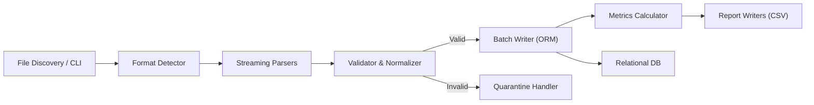

# Project Planning History: LogAnalyticsPipeline

This document outlines the architectural inception, design decisions, technology stack evaluation, and structural specifications established during the initial planning phase of **LogAnalyticsPipeline**.

---

## 1. Problem Statement & Functional Requirements

Modern distributed applications generate heterogeneous logs across multiple services, including:
- Structured JSON arrays (`.json`)
- Line-delimited JSON (`.jsonl`)
- Semi-structured Apache/Nginx-style HTTP text logs (`.log`)

Organizations require a unified, observable, and deterministic ingestion engine capable of:
1. **Multi-Format Streaming Parsing**: Incrementally processing input files without loading entire datasets into memory.
2. **Canonical Normalization**: Standardizing diverse timestamp formats to timezone-aware UTC and mapping arbitrary log levels (`VERBOSE`, `TRACE`, `ERR`, `FATAL`) to canonical RFC-5424 severities (`DEBUG`, `INFO`, `WARNING`, `ERROR`, `CRITICAL`).
3. **Strict Validation & Quarantine**: Validating field constraints (HTTP statuses, nonnegative latencies, required service identifiers) without losing invalid records. Malformed lines must be diverted to durable quarantine storage with explicit failure codes.
4. **Idempotent Storage & Deduplication**: Ensuring re-running pipelines on identical datasets skips duplicate records without errors or inflated counts.
5. **Auditable Run History & Reconciliation**: Maintaining an unalterable ledger of every pipeline execution that strictly adheres to the accounting invariant:
   $$\text{input\_count} = \text{valid\_count} + \text{rejected\_count} + \text{duplicate\_count}$$
6. **Analytics & Aggregation**: Generating hourly and service-level summaries covering request counts, error rates, and latency percentiles (p50, p95, p99).

---

## 2. Technology Stack Selection

| Component | Selected Technology | Rationale |
|---|---|---|
| **Programming Language** | Python 3.10+ / 3.12 | Native typing, rich data engineering ecosystem, cross-platform portability. |
| **Data Validation** | Pydantic v2 | Strict runtime type coercion, high-performance C-core validation, customizable field validators. |
| **Relational ORM & Engine** | SQLAlchemy 2.0 + PyMySQL | Engine-agnostic abstractions, type-safe SQL construction, connection pooling, dialect-native execution. |
| **Analytics Engine** | pandas | Vectorized percentile calculations, group-by aggregations, resilient NaN handling. |
| **Database Engines** | MySQL 8.0+ / SQLite 3.32+ | Dual-engine strategy: MySQL for multi-tenant production; SQLite for local testing, isolated CI, and offline CLI runs. |
| **Testing Harness** | Pytest 8.x / 9.x | Parameterized fixtures, temporary filesystem isolation (`tmp_path`), monkeypatching, and clean reporting. |

---

## 3. Modular Architecture Design

The pipeline was architected around a strict separation of concerns, decoupling parsing, validation, storage, and analytics:

### Module Breakdown
- `src/log_pipeline/parsers/`:
  - `detector.py`: Sniffs file extensions and initial characters to select the appropriate parser.
  - `base.py`: Declares abstract parser interfaces and raw record data contracts (`RawLogRecord`).
  - `json_parser.py`: Generator-based streaming reader for JSON arrays and line-delimited JSON.
  - `text_parser.py`: Regex-based parser for Apache Common/Combined and custom microservice log lines.
- `src/log_pipeline/validation/`:
  - `validator.py`: Executes schema checks and returns `ValidationResult`.
  - `quarantine.py`: Buffers and flushes invalid records to timestamped JSONL exports.
- `src/log_pipeline/models.py`:
  - Canonical Pydantic schemas: `LogEventRecord`, `RejectedRecord`, `CanonicalSeverity`.
- `src/log_pipeline/db/`:
  - `schema.py`: SQLAlchemy declarative models: `PipelineRunModel`, `LogEventModel`, `RejectedRecordModel`.
  - `connection.py`: Thread-safe database engine initialization, connection pooling, and connection lifecycle hooks.
  - `writer.py`: Idempotent multi-row batch execution (`INSERT IGNORE` / `ON CONFLICT DO NOTHING`).
- `src/log_pipeline/metrics/`:
  - `calculator.py`: Pandas aggregations for hourly and service rollups, latency percentiles, and reconciliation accounting.
  - `reporter.py`: Durable CSV report generation.
- `src/log_pipeline/pipeline.py`:
  - Top-level pipeline orchestrator coordinating the lifecycle.
- `src/log_pipeline/config.py`:
  - Multi-tier configuration resolution from constructor arguments, environment variables, `.env`, and defaults.

---

## 4. Database Schema Specifications

### `pipeline_runs` Table
Tracks run-level metadata, lifecycle state, and accounting reconciliation:
- `run_id` (VARCHAR(64), PK): Unique run identifier.
- `start_time` (DATETIME, NOT NULL): UTC initiation timestamp.
- `end_time` (DATETIME, NULL): UTC completion timestamp.
- `status` (VARCHAR(32), NOT NULL): `RUNNING`, `SUCCESS`, `PARTIAL_SUCCESS`, `FAILED`.
- `input_files` (TEXT, NOT NULL): JSON-serialized manifest of requested input paths.
- `input_count`, `valid_count`, `rejected_count`, `duplicate_count` (INTEGER, NOT NULL).
- `failure_details` (TEXT, NULL): Captured traceback in case of abort.

### `log_events` Table
Stores normalized, validated application events:
- `event_id` (VARCHAR(64), PK): Unique event fingerprint (upstream ID or deterministic SHA-256).
- `run_id` (VARCHAR(64), FK -> `pipeline_runs.run_id`, NOT NULL): Lineage run identifier.
- `timestamp` (DATETIME, NOT NULL): Normalized UTC timestamp.
- `service` (VARCHAR(128), NOT NULL): Originating service name.
- `severity` (VARCHAR(16), NOT NULL): Canonical severity level.
- `endpoint` (VARCHAR(255), NULL): HTTP request endpoint.
- `http_status` (INTEGER, NULL): HTTP response code.
- `latency_ms` (FLOAT, NULL): Nonnegative request latency.
- `message` (TEXT, NOT NULL): Application log body.
- `source_file` (VARCHAR(255), NOT NULL), `source_line` (INTEGER, NOT NULL).
- Composite index on `(service, timestamp, severity)`.

### `rejected_records` Table
Stores malformed or invalid inputs for auditability:
- `id` (INTEGER / BIGINT, PK, AUTO_INCREMENT).
- `run_id` (VARCHAR(64), FK -> `pipeline_runs.run_id`, NOT NULL).
- `source_file` (VARCHAR(255), NOT NULL), `source_line` (INTEGER, NOT NULL).
- `raw_record` (TEXT, NOT NULL): Raw string as read from input.
- `rejection_reasons` (TEXT, NOT NULL): JSON list of failure codes.
- `created_at` (DATETIME, NOT NULL).

---

## 5. Architectural Invariants & Assumptions

1. **Strict Accounting Reconciliation**:
   No records may be silently dropped. Every scanned raw record must be categorized as valid (inserted), rejected (quarantined), or duplicate (skipped).
2. **Deterministic Identity**:
   When upstream omits `event_id`, the pipeline generates a deterministic SHA-256 hash:
   `sha256("{source_file}:{source_line}:{service}:{endpoint}:{utc_timestamp}:{message}")`
3. **Idempotent Reruns**:
   Running the pipeline repeatedly against the exact same input file must result in 0 new rows written to `log_events`, 0 errors, and all valid records counted as duplicates.
4. **Timezone Convention**:
   Timezone-naive timestamps are assumed to represent UTC, localized accordingly. Timezone-aware timestamps are converted to UTC.
5. **Zero-Leak Security**:
   Database credentials must never be rendered in clear text in logs, representations (`__repr__`), or CLI outputs.
